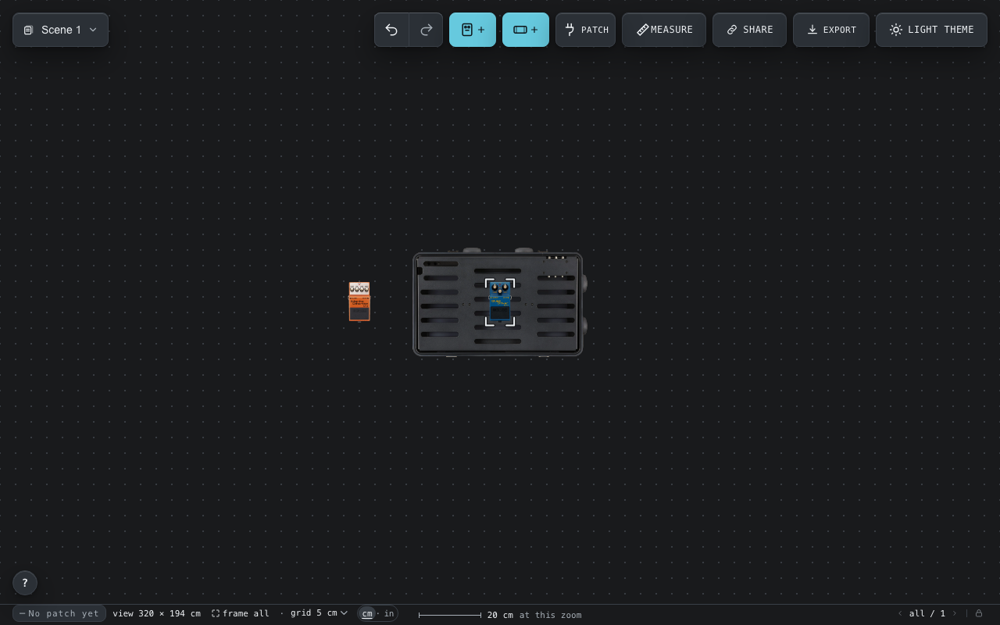

# Pedalvision

> **Project closed for now — 2026-11-25.**
> Pedalvision is no longer under development. It has been **superseded by PedalPlayground v2**, which carries the idea much further. This repository is kept public as a **showcase of the agentic workflow** used to build it — jump to [How this was built](#how-this-was-built) and [`docs/SHOWCASE.md`](docs/SHOWCASE.md).

A 2D true-scale guitar pedalboard planner: place pedals and boards at their real dimensions, route cables, check signal flow and power, and export a true-scale plan.

**Live demo (still up):** https://pedalvision.pages.dev

## What it does

- True-scale 2D canvas — centimetres are the source of truth; pixels exist only at render time.
- 8,800+ pedals and hundreds of boards with real footprints, effect types, jacks and power specs.
- Cables with colours, signal-flow validation and power warnings; undo/redo; local save.
- Read-only share links, PNG/PDF export (true-scale and printable fit-to-page), dark/light themes.
- Responsive desktop and mobile (touch gestures, 44 px targets, keyboard and focus support).

## How this was built (agentic workflow)

The most interesting thing in this repo is *how* it was made: a human owner directing AI agents through a strict, documented process — design gates, review loops, budgets, and one PR per task.

- [`AGENTS.md`](AGENTS.md) — the operating rules: session protocol, design gate, code-review gate, phase gates, token budgets, one-PR-per-task, owner-blocker handling.
- [`.opencode/`](.opencode/) — 12 specialist agents (designer, design-reviewer, code-reviewer, catalog researchers/scouts, pedal expert, performance and token-usage reviewers), 8 slash commands, and a UX-rework skill.
- [`docs/decisions/`](docs/decisions/) — 10 ADRs recording *why*: canvas library, hosting, catalog data, agent context, design/code-review governance, mobile testing, architecture, planner-fill waiver, access model.
- [`docs/tasks/`](docs/tasks/) — 100+ self-contained task files (scope, files to read, acceptance criteria, outcome).
- [`docs/progress.md`](docs/progress.md) — the session-to-session handoff memory: what shipped, checks run, review verdicts, what came next.
- [`docs/design-playbook.md`](docs/design-playbook.md) and [`docs/phase-guide.md`](docs/phase-guide.md) — the UX-rework loop and the phase map.

### See it in action

- [#2](https://github.com/ricardoaxel/pedalvision/pull/2) — the designer ⇄ vision-reviewer loop (7 rounds) that produced the "Blueprint" theme.
- [#108](https://github.com/ricardoaxel/pedalvision/pull/108) — board info/chrome with before/after desktop + mobile screenshots.
- [#109](https://github.com/ricardoaxel/pedalvision/pull/109) — the final task: hover previews + Patch popover focus, with a one-line-per-round review digest.
- [#62](https://github.com/ricardoaxel/pedalvision/pull/62) and the catalog-wave PRs — parallel, budgeted, observable research batches.

## Stack

React 19 · TypeScript · Vite · Konva (react-konva) · Zustand · pnpm · Vitest · Playwright · Biome. Hosted on Cloudflare Pages.

## Commands

| Task          | Command          |
| ------------- | ---------------- |
| Dev server    | `pnpm dev`       |
| Build         | `pnpm build`     |
| Unit tests    | `pnpm test`      |
| Typecheck     | `pnpm typecheck` |
| Lint + format | `pnpm lint`      |
| E2E           | `pnpm e2e`       |

## License

Source code is **MIT** — see [`LICENSE`](LICENSE). Catalog/pedal/board imagery is **third-party and excluded** from the MIT grant — see [`NOTICE`](NOTICE), plus the [attribution](public/attribution.html) and [takedown](public/takedown/index.html) pages.

## Catalog provenance

Catalog facts and images were researched from official, retailer and community sources and recorded per item. The project was **non-commercial** (ADR-009 planner-fill waiver); many images remain marked *license-pending*. Provenance lives in [`docs/catalog/`](docs/catalog/) and the ledgers under `data/catalog/`. If you are a rights holder, please use the takedown page.

See [`docs/requirements.md`](docs/requirements.md) and [`docs/design.md`](docs/design.md) for the full product and architecture spec.
